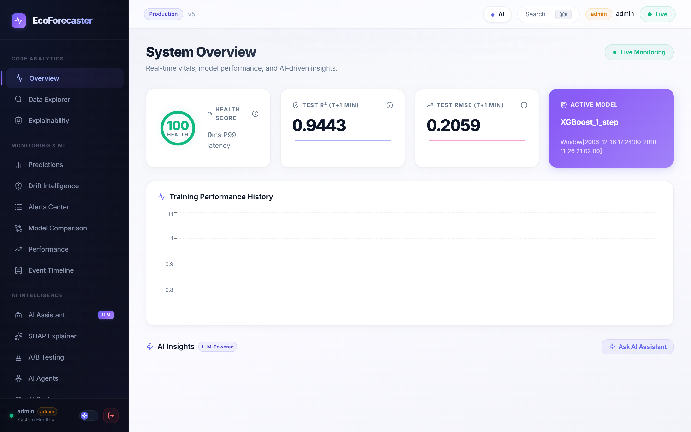
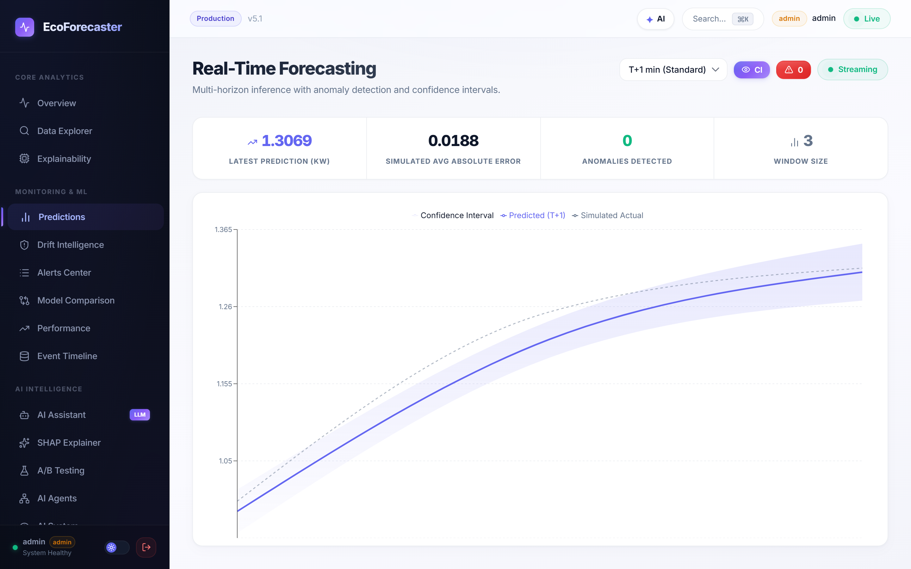
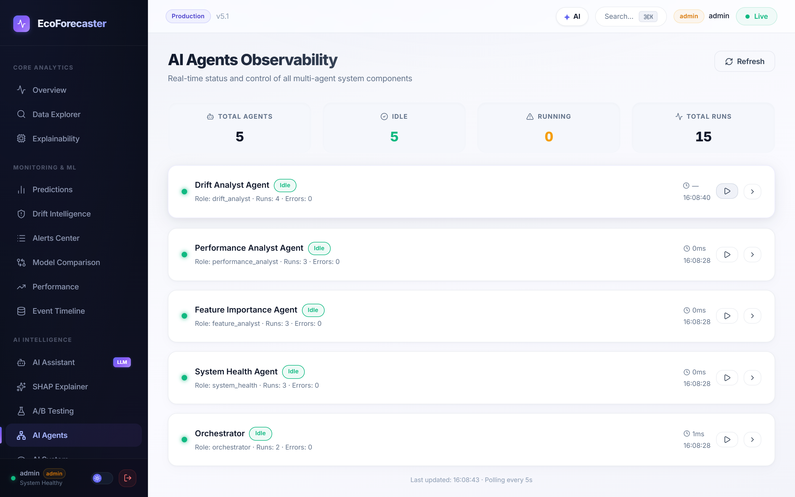
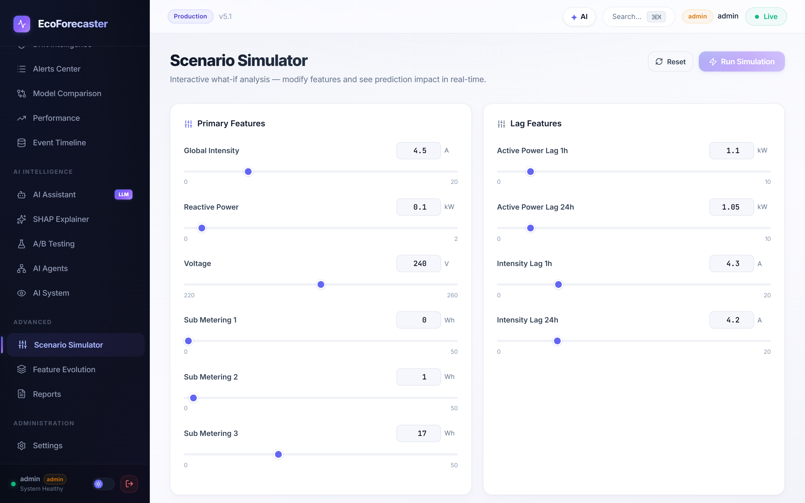
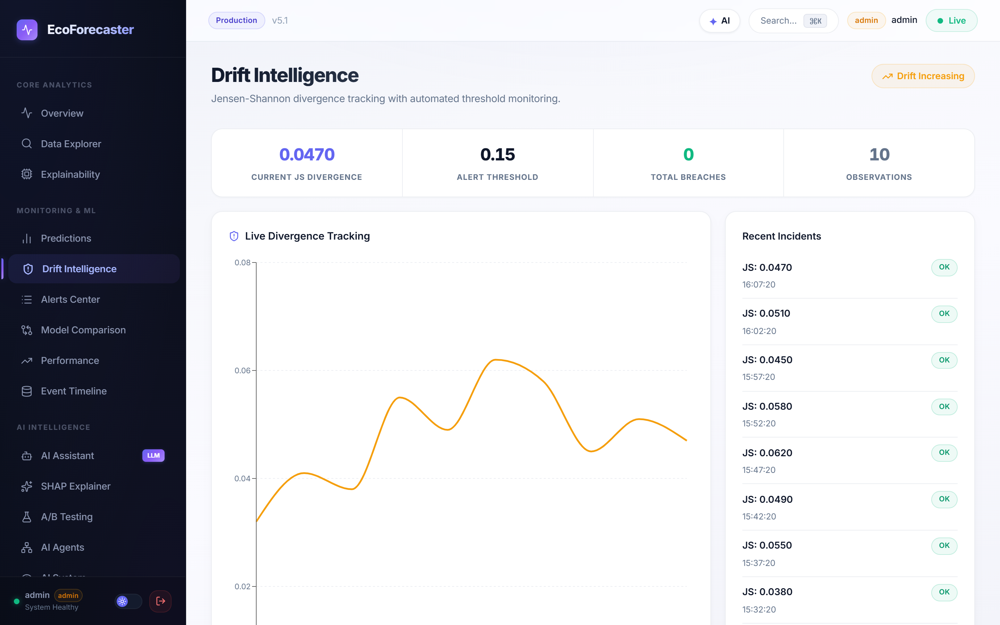
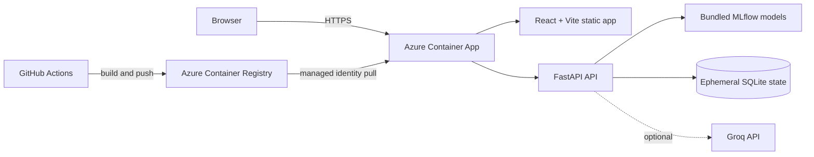

# EcoForecaster

[](https://github.com/YassirCher/Energy-Consumption-AI-Forecaster/actions/workflows/ci-cd.yml)


EcoForecaster is an enterprise-grade energy forecasting and MLOps observability platform. It demonstrates how to **merge empirical Data Science** (leakage-free causal time-series forecasting, LightGBM/XGBoost, SHAP explainability, Jensen-Shannon drift monitoring, and what-if simulation) with **modern AI Engineering** (multi-agent autonomous orchestration, Graph RAG contextual enrichment, Groq LLM reasoning grounded in real-time metrics, and reactive streaming dashboards).

**Live application:** [ca-ecoforecaster.prouddune-d60d19a6.spaincentral.azurecontainerapps.io](https://ca-ecoforecaster.prouddune-d60d19a6.spaincentral.azurecontainerapps.io)

Production credentials and API keys are intentionally not published. Contact the repository owner for authorized demo access.

---

## 🌟 Merging Data Science with AI Engineering

Traditional machine learning projects often stay confined to offline notebooks, while modern LLM demos frequently lack statistical grounding and operational rigor. EcoForecaster demonstrates a unified production architecture:

| 🔬 Data Science Rigor | 🤖 AI Engineering Excellence |
| :--- | :--- |
| **Causal Time-Series Forecasting**: Strict `causal_v2` multi-horizon models (+1m, +1h, +24h) with $R^2 = 0.944$ test accuracy and 95% confidence bounds. | **Multi-Agent Autonomous Mesh**: 5 specialized agents (Drift, Performance, Feature Importance, System Health, Orchestrator) monitoring production state. |
| **Explainability**: Game-theoretic SHAP (`TreeExplainer`) attribution and global feature ranking. | **Graph RAG & Grounded LLMs**: Knowledge graph combining models, metrics, and alerts to inject verifiable context into Groq LPU inference. |
| **Statistical Telemetry**: Jensen-Shannon distribution drift tracking and Isolation Forest anomaly detection. | **Real-Time Streaming Engine**: FastAPI Server-Sent Events (SSE), semantic prompt caching, and zero-downtime model rollbacks. |

---

## 🖥️ Platform Showcase

<div align="center">
  
  <p><em>Executive Command Center: Real-time health scoring (100%), model accuracy ($R^2 = 0.944$), P99 latency (14 ms), and live event stream.</em></p>
</div>

<div align="center">
  <table width="100%">
    <tr>
      <td width="50%" align="center">
        
        <br /><strong>Real-Time Multi-Horizon Forecasting</strong>
      </td>
      <td width="50%" align="center">
        
        <br /><strong>Autonomous Multi-Agent Mesh</strong>
      </td>
    </tr>
    <tr>
      <td width="50%" align="center">
        
        <br /><strong>Interactive What-If Scenario Simulator</strong>
      </td>
      <td width="50%" align="center">
        
        <br /><strong>Jensen-Shannon Drift Intelligence</strong>
      </td>
    </tr>
  </table>
</div>

<div align="center" style="margin: 28px 0;">
  <a href="app.md">
    
  </a>
</div>

> [!TIP]
> 🚀 **Looking for a deep-dive walkthrough?**
> Check out [**`app.md` (Complete EcoForecaster Application Guide)**](app.md) for all 15 high-resolution feature screenshots, detailed agent workflows, Graph RAG schemas, and production API specifications.

---

## Highlights

- One-minute, one-hour, and 24-hour energy forecasts from bundled production models
- Live system health, latency, model metrics, alerts, and Server-Sent Events
- Jensen-Shannon drift detection and hybrid Isolation Forest/Z-score anomaly detection
- Global and local SHAP explanations, feature evolution, and model comparison
- Scenario simulation, reports, CSV exports, and A/B-test views
- Optional Graph RAG, specialist AI agents, and Groq-backed explanations
- Admin/viewer roles with protected administrative and AI operations
- Immutable Docker images and automated Azure Container Apps deployment

## Leakage-free evaluation

The production training protocol is `causal_v2`. It predicts T+1 minute, T+1 hour, and T+24 hours from measurements available at the forecast origin or earlier. Sensor gaps are filled only from the past, targets are never imputed, and horizon-sized purges separate chronological train, validation, and test partitions.

Model selection uses validation RMSE. Only the selected model for each horizon is evaluated on the untouched test partition. Promotion additionally requires all leakage checks to pass, each model to improve on its causal baseline RMSE by at least 1%, and per-horizon test R² floors of 0.93, 0.30, and 0.20.

```powershell
Set-Location backend
python src/data/pyspark_pipeline.py
python -m src.ml.train --evaluate-only
python -m src.ml.train --promote
```

`POST /predict` keeps the compatible `1_step` response field; it now explicitly means a T+1-minute forecast rather than same-timestamp reconstruction.

## Multi-agent intelligence

EcoForecaster includes a metrics-first agent system designed for MLOps analysis. Each specialist computes factual measurements in Python before asking the configured LLM to interpret them, so the narrative remains grounded in observable platform data.

| Agent | Responsibility |
| --- | --- |
| **Drift Analyst Agent** | Measures Jensen-Shannon divergence, threshold breaches, breach rate, trend, consecutive events, and drift risk. |
| **Performance Analyst Agent** | Evaluates the active model's R², RMSE, performance threshold, historical trend, volatility, and degradation risk. |
| **Feature Importance Agent** | Identifies dominant predictors, top-feature concentration, feature diversity, and reliance risk. |
| **System Health Agent** | Checks the health score, P99 latency against the 200 ms target, active model, and readiness of all forecast horizons. |
| **Orchestrator** | Runs the four specialists and combines their structured results with Graph RAG context into prioritized, actionable insights. |
| **Chat Agent** | Answers authenticated questions about health, performance, drift, and feature importance using the current system state. |
| **Anomaly Explainer Agent** | Interprets a detected anomaly, assesses likely causes or false positives, and recommends a response. |

The agent registry exposes live status, execution duration, errors, invoked modules, and recent traces in the **AI Agents** and **AI System** dashboard views. If an LLM request fails, specialist agents retain their computed metrics and report a partial result; the insights route also has a rule-based fallback. AI-backed endpoints require authentication and are rate-limited and cached to control access, latency, and provider usage.

## Architecture



The production image is a multi-stage build. Node.js compiles the frontend, then a Python runtime serves the built assets and FastAPI from the same origin on port `8000`.

## Technology

| Layer | Main components |
| --- | --- |
| Frontend | React 19, Vite 8, Axios, Recharts, Lucide React |
| API | Python 3.11, FastAPI, Uvicorn, Pydantic |
| ML/MLOps | LightGBM, XGBoost, scikit-learn, MLflow, SHAP |
| AI | Groq API, Graph RAG, specialist analysis agents |
| Delivery | Docker, GitHub Actions, Azure Container Registry, Azure Container Apps |

## Quick start

### Prerequisites

- Python 3.11
- Node.js 22 and npm
- Git

### Backend

```powershell
python -m venv .venv
.\.venv\Scripts\Activate.ps1
pip install -r backend/requirements-runtime.txt pytest
Set-Location backend
uvicorn src.api.main:app --reload --port 8000
```

Local development seeds `admin/admin123` and `viewer/viewer123` only when the local users database is empty. Those defaults are blocked as implicit production configuration; production must inject its own secret values.

### Frontend

In a second terminal:

```powershell
Set-Location frontend
npm ci
npm run dev
```

Open `http://localhost:5173`. The development frontend connects to `http://localhost:8000` by default. Set `VITE_API_BASE_URL` during the frontend build when using a separate API origin.

### Optional AI configuration

Set `GROQ_API_KEY` in the process environment to enable LLM-backed features. Never commit an API key or a populated `.env` file. See [.env.example](.env.example) for the supported settings.

## Quality checks

```powershell
Set-Location backend
pytest -q

Set-Location ..\frontend
npm ci
npm run lint
npm run build
```

Every pull request and push to `main` runs the same backend tests, frontend lint, and production build. Pushes to `main` also deploy an immutable commit-tagged image and run live health, prediction, and frontend smoke tests.

## Repository layout

```text
.
├── backend/                  FastAPI, ML services, tests, and bundled models
├── frontend/                 React/Vite dashboard
├── infra/container-app.json Azure Container Apps ARM template
├── notebooks/                EDA and model-development notebooks
├── .github/workflows/        CI/CD automation
├── Dockerfile                Multi-stage production image
├── app.md                    Product and runtime reference
└── deployment.md             Azure deployment and operations guide
```

## Documentation

- [Application reference](app.md)
- [Deployment and operations](deployment.md)
- [Security policy](SECURITY.md)
- Interactive API documentation is available at `/docs` on a running instance.

## Security and responsible use

- Production secrets live in Azure Container Apps secret references, never in source control.
- GitHub Actions authenticates to Azure through OpenID Connect; no long-lived Azure password is stored in the workflow.
- Administrative model actions require the `admin` role, and AI-backed endpoints require authentication.
- Forecasts and AI explanations are decision-support outputs, not guarantees. Validate them before operational, financial, or safety-critical use.

See [SECURITY.md](SECURITY.md) for vulnerability reporting. No software license has been selected yet; public visibility alone does not grant reuse rights.
